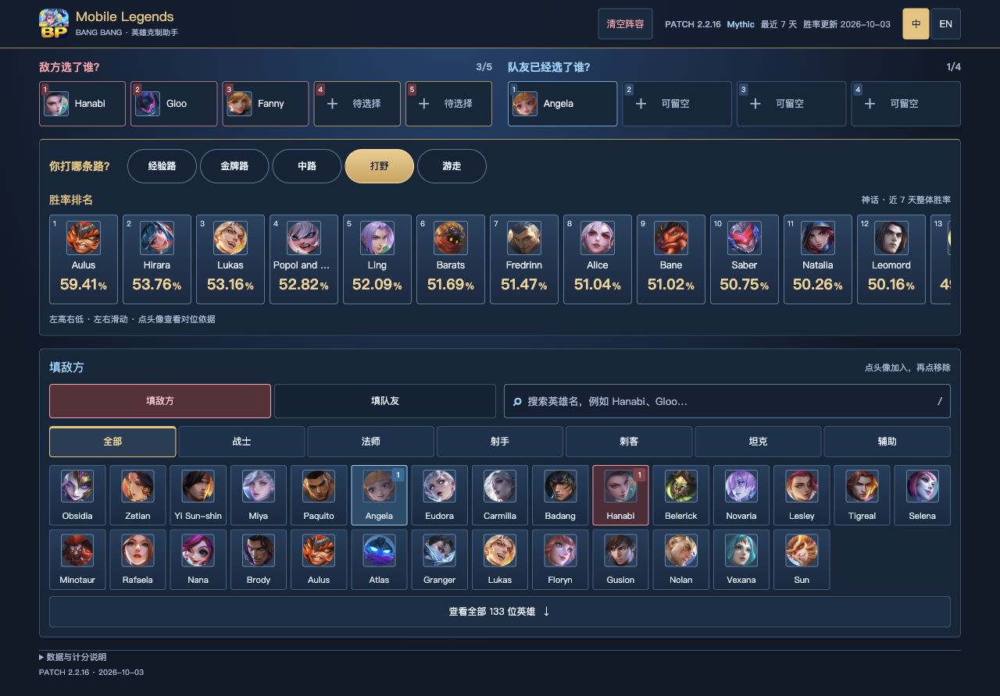
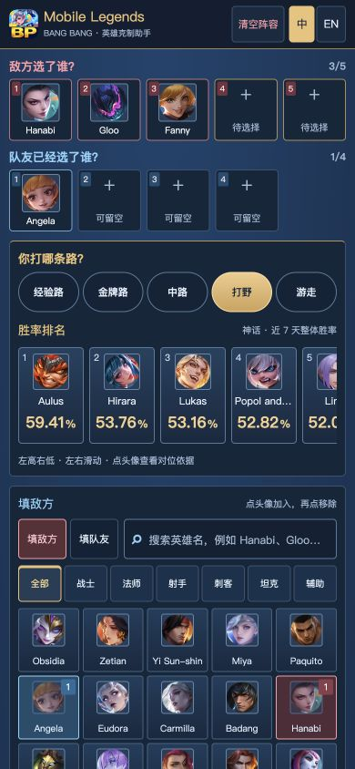
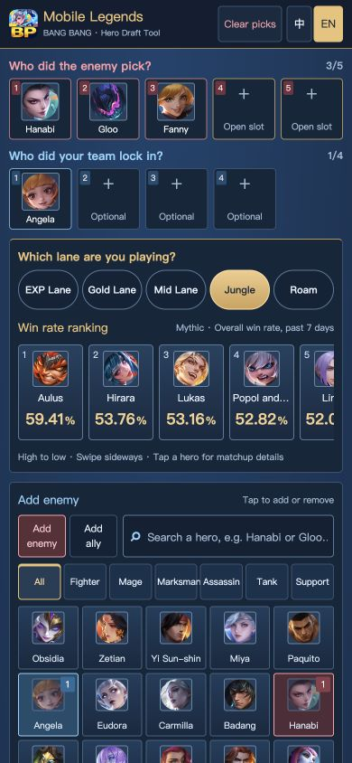

<div align="center">

# Counter Ready · 决胜巅峰克制助手

**Know the enemy lineup, pick the right hero.** A bilingual Mobile Legends: Bang Bang draft assistant with a compact, scrollable matchup-based ranking.<br>
**看清敌我，选对英雄。** 中英双语的《决胜巅峰》选英雄工具，根据敌我阵容推荐英雄，左右滑动查看。

<a href="https://guigulaoshi.github.io/counter-ready-mlbb/"></a>

**[▶ Play it now / 在线使用](https://guigulaoshi.github.io/counter-ready-mlbb/)** — runs in the browser, nothing to install / 打开网页即可使用，无需安装。

<a href="https://guigulaoshi.github.io/counter-ready-mlbb/"></a>

</div>

> A fast, bilingual Mobile Legends: Bang Bang (国服《决胜巅峰》) draft assistant with a horizontal matchup-based ranking and measured matchup details, powered by a local Mythic statistics snapshot.

一个快速、中英双语的《决胜巅峰》（Mobile Legends: Bang Bang）选英雄工具：按敌方克制与队友配合综合分展示一排英雄推荐，并提供对应的实测依据，使用本地神话统计快照。

## Screenshots / 截图

<table>
  <tr>
    <td width="50%"></td>
    <td width="50%"></td>
  </tr>
  <tr><td align="center">Phone, 中文 / 手机中文版</td><td align="center">Phone, English / 手机英文版</td></tr>
</table>

<sub>Layout reference from the earlier win-rate build; the current ranking uses matchup scores. Phone viewport: 390×844. / 截图为此前胜率版的布局参考；当前排名已恢复为克制与配合综合分。手机尺寸：390×844。</sub>

## Play / 在线使用

<https://guigulaoshi.github.io/counter-ready-mlbb/>

The site is static and works on desktop and phone browsers. No install, no account.

网页版为静态页面，电脑和手机浏览器都能直接打开，无需安装、无需账户。

## Features / 功能

- Select 1–5 enemy heroes and up to 4 locked-in teammates / 选择 1–5 名敌方英雄，以及最多 4 名已确定的队友
- Filter recommendations by EXP, Gold, Mid, Jungle or Roam / 按五个分路筛选
- One horizontally scrollable row, ranked by counter and synergy score from high to low / 一排可左右滑动的英雄，按克制与配合综合分从高到低排序
- Tap a ranked hero to inspect measured counter and synergy relationships / 点击排名里的英雄查看实测克制与配合依据
- Automatically follows the browser language, with a manual 中文/EN switch / 根据浏览器语言自动选择中英文，也可手动切换
- Responsive desktop and mobile layouts / 同时适配桌面和手机
- No account, backend or user-tracking features / 无需账户、后端或用户追踪

## Ranking and matchup details / 排名与对位依据

Recommendations recalculate whenever enemies, allies or lane change. Score = mean signed counter edge across all selected enemies + mean synergy edge across all selected allies. Reverse counters subtract from the score; missing relationships count as unknown (0). Global win, pick and ban rates never affect ranking, even as a tie-breaker. Equal scores use counter coverage, then name.

敌方、队友或位置改变时，推荐即时重算。综合分 = 对全部已选敌方的平均克制值 + 与全部已选队友的平均配合值。被敌方克制会扣分，未知关系按 0 处理。全局胜率、选取率和禁用率均不参与排序；同分时依次比较克制覆盖人数、英雄名。

Only available lane picks with a positive score are recommended. With no picks or no positive evidence, the row shows a prompt instead of falling back to popular or high-win-rate heroes. Tap a hero for the score breakdown and measured relationships. Scores are percentage-point indicators, not predicted match win rates.

只推荐当前分路、尚未被选走且综合分为正的英雄。未选阵容或没有正分依据时显示提示，不用高胜率英雄补位。点击英雄可查看分数构成及克制、配合依据。分数单位为百分点（pp），不是本局预测胜率。

## Data / 数据

- Patch 2.2.16 · Season 42
- Statistics source updated / 胜率源数据更新：2026-10-03 01:04:06 UTC
- Retrieved / 本次抓取：2026-10-03 13:34:38 UTC
- 133 heroes / 133 位英雄
- 1,172 fresh counter edges and 573 synergy pairs / 1,172 条通过时效检查的克制关系和 573 对配合关系
- Win, pick and ban rates use **Mythic only, Past 7 days**, requested explicitly from [MLBB.io](https://mlbb.io/api/hero/filtered-statistics?rankId=4&timeframeId=3) (`rankId=4`, `timeframeId=3`). No averaging with other ranks / 胜率、选取率、禁用率固定为**仅神话段位、最近 7 天**，不与神话荣耀等段位混合。
- Every returned statistic must match that scope and have a source timestamp within 48 hours; otherwise the refresh fails without replacing the snapshot. The displayed date is the source update date, not the retrieval date / 逐条检查段位、周期和源数据时间；数据超过 48 小时或口径不符就停止更新。页面日期展示来源更新时间，不再用抓取日期代替。
- Counters come from mlbb.tools with `rank_tier=mythic`, `time_window=7d`, and a valid `updated_at` within seven days of retrieval. 4,493 stale, undated or wrong-scope records were excluded from this snapshot. Source record updates span September 27–October 3; this does not prove every record covers the same latest calendar week / 克制数据仅保留神话、七天统计窗口、且近七天更新的记录，本次排除 4,493 条不合要求的记录。保留记录的更新时间为 9 月 27 日至 10 月 3 日，并不代表每条数据都覆盖同一个最新自然周。
- Fresh counter coverage can be empty or incomplete; missing relations count as unknown (0), never as proof of no counter / 清理旧记录后，部分英雄的克制关系可能缺失；未收录关系按未知（0）处理，不表示不存在克制。
- Synergy uses only the Mythic hero pages' "Best With" block. Its source publishes neither a statistics window nor update timestamps, so it **cannot be verified as current seven-day data**. The UI labels this limitation / 配合关系仅取神话英雄页的 "Best With" 区块；来源未公开统计周期和更新日期，**不能确认属于最新七天数据**，页面已明确提示。
- Every edge is clipped at 15pp so one thin sample cannot dominate a recommendation / 所有数值上限截断在 15pp，避免单个小样本对位主导推荐结果

This is a static snapshot and does not update automatically. Run `npm run data:update-matchups` and update the displayed patch metadata after a game patch. The script rewrites `app/matchups.generated.ts`, refreshes the explicitly scoped MLBB.io win, pick and ban rates in `app/data.ts`, and syncs each hero's role, lane and specialty tags from the official Moonton hero list; it warns when any edge hits the clipping ceiling. mlbb.tools' own patch label can lag the live game, so set the patch in `DATA_META` from the official patch notes.

这是静态快照，不会自动更新。游戏换版本后，运行 `npm run data:update-matchups`，并同步更新页面版本信息。脚本会重写 `app/matchups.generated.ts`，从 MLBB.io 刷新 `app/data.ts` 里明确指定神话、最近七天的胜率、选取率和禁用率，并从官方英雄列表同步每位英雄的定位、分路和特长标签；mlbb.tools 自己标注的版本号可能落后于游戏实际版本，`DATA_META` 里的版本请以官方更新公告为准；有数值触及截断上限时会给出告警。

## Local development / 本地运行

Requires Node.js 22.13 or newer / 需要 Node.js 22.13 或更新版本。

```bash
npm install
npm run dev
```

Press `/` to focus search and `Esc` to clear it. / 按 `/` 聚焦搜索框，按 `Esc` 清空搜索。

## Build and test / 构建与测试

```bash
npm test
```

`npm run build:pages` produces the static GitHub Pages site in `pages-dist`. Pushes to `main` are deployed by GitHub Actions.

`npm run build:pages` 会在 `pages-dist` 生成 GitHub Pages 静态网页；推送到 `main` 后由 GitHub Actions 自动发布。

## License

MIT. Mobile Legends: Bang Bang (国服《决胜巅峰》) and its hero artwork belong to their respective rights holders. This fan-made project is not affiliated with or endorsed by Moonton.

MIT 开源。本项目为非官方玩家工具，与 Moonton 无隶属或背书关系。

## Made by / 作者

guigulaoshi · [itch.io](https://guigulaoshi.itch.io) · [GitHub](https://github.com/guigulaoshi) · [YouTube](https://www.youtube.com/@guigulaoshi) · [X](https://x.com/guigulaoshi) · [TikTok](https://www.tiktok.com/@guigulaoshi) · [抖音](https://www.douyin.com/user/MS4wLjABAAAAmWbEAlX8SvUu3RUFu48ArUSOqK9-2cTOC78Byiqe0GY) · [哔哩哔哩](https://space.bilibili.com/3546730639395688) · [小红书](https://www.xiaohongshu.com/user/profile/6090be480000000001005d88)

Icon artwork attribution: [Third-party notices](THIRD_PARTY_NOTICES.md).

图标素材来源及版权：[第三方声明](THIRD_PARTY_NOTICES.md)。
